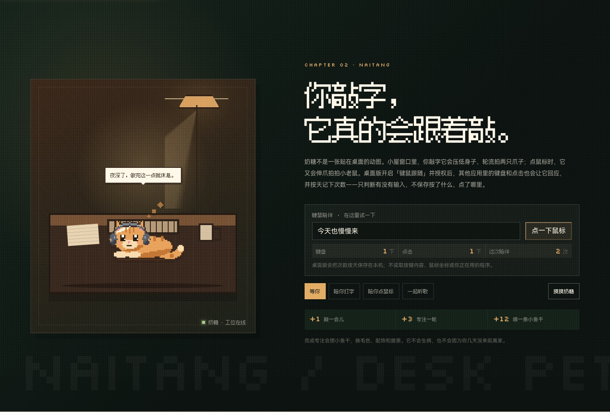

<div align="center">


# 心流小屋 · Flow Cabin

**听一张喜欢的唱片，安心做完这一轮，再把日子轻轻收好。**

一间会下雪、会亮灯、会等你回来的像素小屋。<br>
<sub>A local-first pixel cabin for records, focus, and a tiny companion.</sub>

<p>
<a href="https://album-circle.vercel.app/promo.html"><b>走进宣传网站 →</b></a>
&nbsp;&nbsp;·&nbsp;&nbsp;
<a href="https://github.com/ooooooomygosh/album-web/releases/latest"><b>下载桌面版 ↓</b></a>
&nbsp;&nbsp;·&nbsp;&nbsp;
<a href="docs/getting-started.md">第一次使用</a>
</p>

<a href="https://album-circle.vercel.app/promo.html">
  
</a>

<sub>真实运行界面 · macOS / Windows · 无需注册账号</sub>

</div>

## 一间小屋，三件日常

<table>
<tr>
<td width="33%" valign="top">

### 听

**把专辑放回生活里。** 唱片架、落针的唱机、曲目笔记和专辑墙。不是永远播不完的背景音，而是一次认真听完一张唱片。

</td>
<td width="33%" valign="top">

### 专注

**让注意力回到今天。** 番茄钟、待办、翻页钟、统计和词书放在同一张桌上。完成一轮，就留下一点看得见的进展。

</td>
<td width="33%" valign="top">

### 记得

**给日子一个安静的位置。** 随手记、手记和小屋来信慢慢收成一本年鉴。没有社交 feed，也没有已读压力。

</td>
</tr>
</table>

## 小屋里有什么

- **唱片与唱机**：十二格唱片架、黑胶特写、可拖动唱臂、曲目笔记、唱片盒和专辑墙；支持本地音乐、QQ 音乐 / 网易云、系统正在播放与 Music Assistant。
- **专注与记录**：四档番茄节奏、待办、每日目标、连续天数、7 天趋势与一年热力图；手记和整组来信都可以慢慢回看。
- **学习与词书**：FSRS 闪卡、内置主题词书、考试倒计时和专注热力图，把学习也放进同一间屋。
- **声音与房间**：程序实时合成雨、火、风、白噪与黑胶底噪；Lo-fi 电台会为唱机让路，窗光和房间配色随时间变化。

> **本地优先。** 收藏、笔记、专注记录、待办、手记和伴读统计都保存在本机，可随时导出 / 导入；平台凭据通过 Electron safeStorage 加密保存。

## 奶糖会陪你用电脑

<div align="center">
  
</div>

不止是窗内的动画。桌面版开启「键鼠跟随」后，即使心流小屋在后台，你打字时它也会轮流落爪，点击鼠标时它会伸手回应。

- **有回应，也有分寸。** 记录今天的键盘 / 点击次数、连续陪伴天数与最近 7 天；完成专注赚到的小鱼干可以换配饰。
- **只看动作，不看内容。** 只处理事件类型与时间戳，不保存按键、鼠标按钮、坐标、应用名或窗口标题。
- **不会用愧疚留住你。** 几天不开门，奶糖也不会生病、掉级或离开；它只是把灯留着。

<sub>macOS 首次使用需授予辅助功能 / 输入监控权限；应用回到前台时会重新检查授权状态。</sub>

## 六间房，一页可以走进去的小屋年鉴

<a href="https://album-circle.vercel.app/promo.html">
  
</a>

**像素小屋 · 琥珀小屋 · 月夜书桌 · 林间书屋 · 海边慢屋 · 星夜阁楼**

六间房有自己的窗光、天气与可以伸手碰一碰的小物。在[「小屋年鉴」](https://album-circle.vercel.app/promo.html)里切换晨光、午后、黄昏和夜深，看看晴、雨、雪落在窗前，也可以试玩唱机、翻页钟、词卡、来信，以及奶糖如何回应你的键鼠。

[**打开宣传网站 →**](https://album-circle.vercel.app/promo.html) · [直接试用网页版 →](https://album-circle.vercel.app/)

## 下载

[**前往最新版 Releases 选择安装包 →**](https://github.com/ooooooomygosh/album-web/releases/latest)

| 平台 | 安装包 |
| --- | --- |
| macOS | Apple Silicon · Intel |
| Windows | x64 安装版 · 便携版 |

当前构建未完成商业签名与公证；首次打开如遇系统提示，请先核对下载来源，并阅读[安装说明](docs/getting-started.md#安装与首次打开)。

## 快速开始

需要 **Node.js 24.x**。

```bash
git clone https://github.com/ooooooomygosh/album-web.git
cd album-web
npm ci
npm --prefix desktop ci

npm run desktop:dev   # 启动完整 Electron 客户端
npm run dev           # 只启动浏览器渲染层
```

提交前运行 `npm run check`，它会执行测试与生产构建。更多命令见 [desktop/README.md](desktop/README.md)。

## 技术栈与文档

React 19 · Vite 8 · Electron 44 · Tone.js · Web Audio · FSRS · `node:test` · Playwright

[架构说明](docs/architecture.md) · [桌面开发](desktop/README.md) · [美术规范](docs/art-direction.md) · [播放器与音源](docs/player.md) · [使用边界](docs/limitations.md)

## 参与贡献

欢迎提交 Issue、修复 Bug 或补充真实设备验证。开始前请阅读[贡献指南](CONTRIBUTING.md)与[使用边界](docs/limitations.md)。

## 许可与致谢

专辑封面版权归各唱片公司 / 艺术家所有，仅用于界面展示，不包含在项目许可范围内。项目代码与第三方模块的许可边界见[许可与依赖](docs/limitations.md#许可与依赖)。

灵感来自 [Bongo Cat](https://github.com/ayangweb/BongoCat) 的跨应用键鼠陪伴思路，以及 Chill Pulse、lofi-engine 等作品；角色与场景美术均为本项目原创。感谢 [Tone.js](https://tonejs.github.io/)、[Simple Music](https://github.com/Yyyangshenghao/simple-music)（GPL-3.0-only，来源见 [SOURCE.txt](desktop/vendor/simple-music/SOURCE.txt)）、[Music Assistant](https://github.com/music-assistant/server) 与像素字体 [Fusion Pixel](https://github.com/TakWolf/fusion-pixel-font)。

<div align="center">
<sub>Made with ☕ and lo-fi in a small pixel cabin.</sub>
</div>
