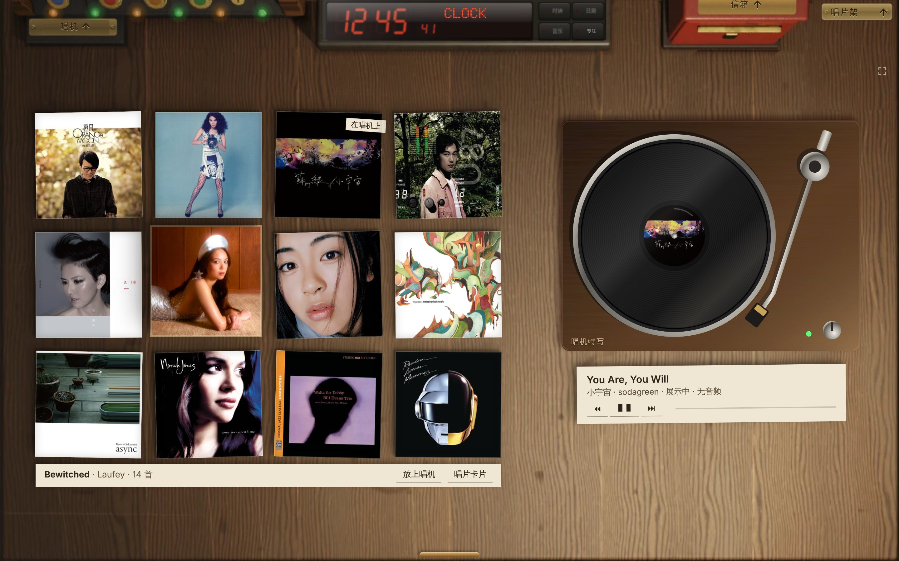
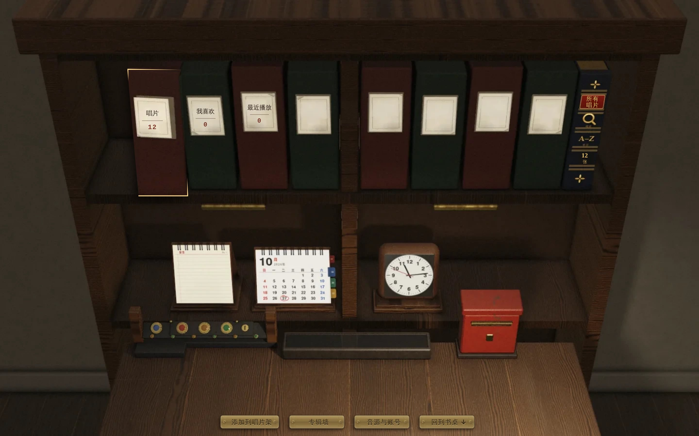
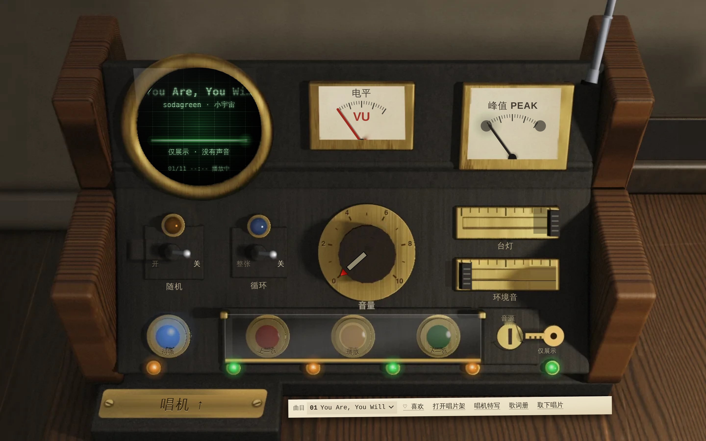
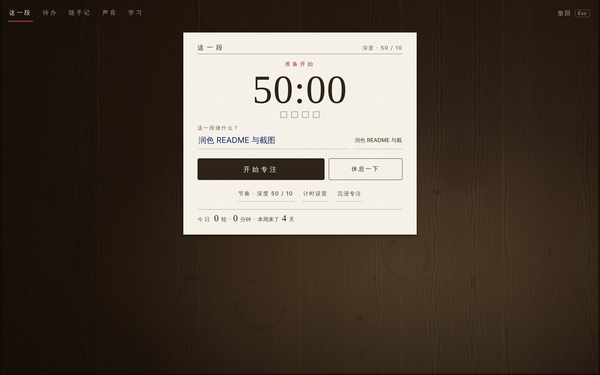
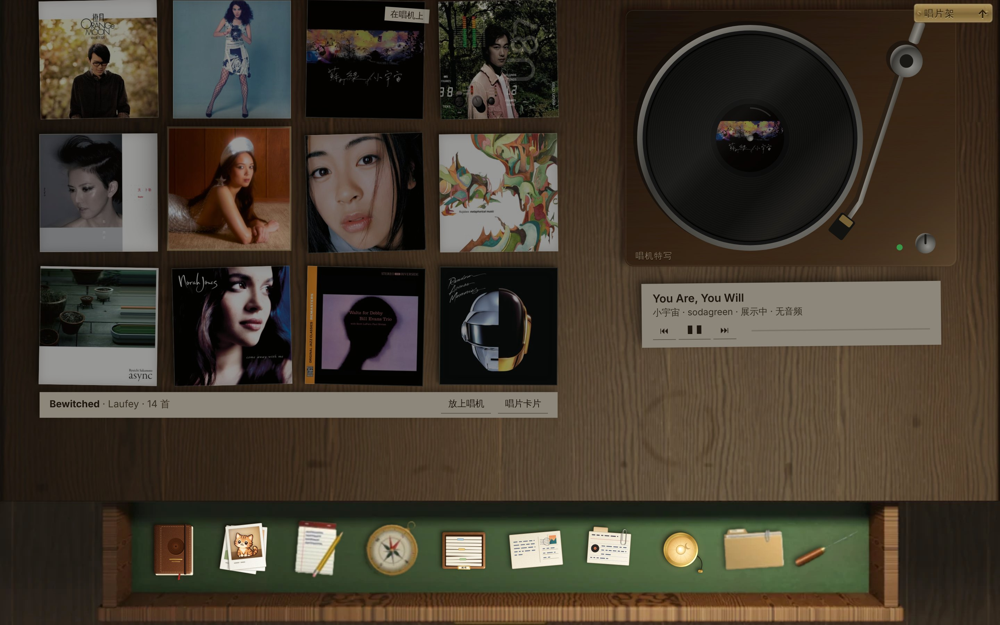
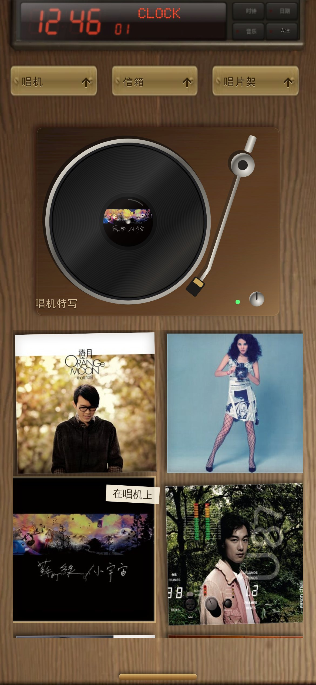
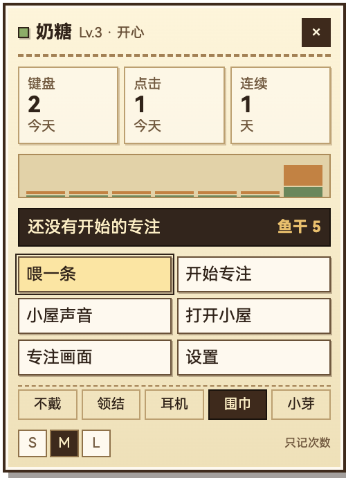

<div align="center">


# 心流小屋 · Flow Cabin

**听一张喜欢的唱片，安心做完这一轮，再把日子轻轻收好。**

<sub>一张胡桃木书桌：唱片摊在桌上，唱机在右手边，台钟在后沿，抽屉里放着日记和伙伴。</sub>

<p>
  <a href="https://github.com/ooooooomygosh/Flow-Cabin/releases/latest"><b>下载最新版 ↓</b></a>
  &nbsp;·&nbsp;
  <a href="https://album-circle.vercel.app/promo.html">宣传网站</a>
  &nbsp;·&nbsp;
  <a href="https://album-circle.vercel.app/">网页版</a>
  &nbsp;·&nbsp;
  <a href="docs/getting-started.md">第一次使用</a>
</p>

<p>
  <a href="https://github.com/ooooooomygosh/Flow-Cabin/actions/workflows/ci.yml"></a>
  <a href="https://github.com/ooooooomygosh/Flow-Cabin/releases/latest"></a>
  
  
  <a href="LICENSE"></a>
</p>



</div>

---

## 里面有什么

3.1 起，首页是一张从上往下看的书桌。画面、材质、灯光和转场照搬开源项目 [DEsk](https://github.com/fyzugx/DEsk)（MIT），内容是心流小屋自己的：唱片、专注、唱片日记和伙伴。整个界面只有两种视角：低头看桌面，抬头看一件东西。

- **唱片就摊在桌上** —— 专辑封面一叠十二张铺在胡桃木上，右手边是唱机。双击封面、按回车，或者把它拖到唱机上就开始放；唱机下的纸条写着正在放什么，可以上一首、暂停、下一首。PageUp / PageDown 翻到下一叠。
- **抬头看唱片架（A）** —— 一整面书柜：活页夹是唱片盒（全部、我喜欢、最近播放和你自己建的），深蓝色的索引本按 A–Z 找唱片；下层的台历、便签本、时钟和邮筒分别通向待办、随手记、番茄钟和信箱。
- **抬头看唱机（C）** —— 一台电子管控制台：圆形荧光屏显示歌名和歌词，两只表随音乐摆动，旋钮调音量，拨杆切随机和循环，推子调台灯和环境音，钥匙换音源。
- **LED 台钟** —— 后沿的红色台钟平时报时；按键可以换成日期、正在放的歌或专注倒计时。点钟面开始一段专注。
- **专注** —— 一张纸上写「这一段做什么」，四档番茄节奏、待办、随手记、环境音和学习都在旁边几页；沉浸专注是一只满屏的大钟。做完一段会压成一张唱片，留在唱片日记里。
- **抽屉（D）** —— 唱片日记、伙伴的照片、随手记、窗外与天气、备份和设置（那把螺丝刀）。实验室打开后还有词书、明信片、场景配方和睡前模式。
- **信箱（N）** —— 新手引导、版本说明和提示都是寄来的信。
- **纸** —— 每个面板都是一张纸，掀起折角可以收起成一个纸包放在桌上、铺满整个桌面，或者放回去。按下去有纸、抽屉和按键的声音，设置里可关。
- **音源** —— 本地音乐、QQ 音乐 / 网易云（非官方接口）、系统正在播放、Music Assistant，或者只看唱片转不出声。
- **智能唱片机** —— 说一句「学习 50 分钟，帮我搭配音乐」，AI 排一整张歌单（实验室功能，需要自己配置 AI）。
- **五位伙伴** —— 桌面版有独立的桌宠和 macOS 菜单栏小宠物；「沉入桌面」会把这张书桌铺在所有窗口下面。
- **手机** —— 窄屏时台钟在上，三块铜牌一排，唱机在中间，封面两列往下滚，抽屉在最下面。Android 版见 [Android 说明](docs/android.md)，仍待真机验收。

<table>
  <tr>
    <td width="50%"><br><sub>唱片架 · 活页夹与 A–Z 索引本</sub></td>
    <td width="50%"><br><sub>唱机 · 电子管控制台</sub></td>
  </tr>
  <tr>
    <td width="50%"><br><sub>专注 · 这一段做什么</sub></td>
    <td width="50%"><br><sub>抽屉 · 日记、伙伴、设置都在这里</sub></td>
  </tr>
</table>

<p align="center"></p>

---

## 奶糖会陪你用电脑

<div align="center">
  
</div>

桌面版在「设置 › 键鼠陪伴」打开跨应用陪伴后，即使心流小屋在后台，你打字时它也会轮流落爪，点击鼠标时它会伸手回应。完成专注赚到的小鱼干可以换配饰。

只处理事件类型与时间戳，不保存按键、鼠标按钮、坐标、应用名或窗口标题。几天不开门，奶糖不会生病也不会离开，等级更不会掉；只是心情会慢慢降到「无精打采」停在那里，等你回来。

<sub>macOS 首次使用只需授予「输入监控」。普通字母和数字已在真实 Mac 上验证过；中文输入法组合还没有在真机上验收。版本更新后引导会复核一次，已授权时不会重复弹窗。</sub>

---

## 下载

[**前往 Releases 选择安装包 →**](https://github.com/ooooooomygosh/Flow-Cabin/releases/latest)

当前版本 **v3.1.0**，逐版本改动见[发布说明](desktop/RELEASE-NOTES.md)。

| 平台 | 安装包 |
| --- | --- |
| macOS | Apple Silicon · Intel（DMG 或 ZIP） |
| Windows | x64 安装版 · x64 便携版 |

没有你的系统，或暂时不想安装？先用[网页版](https://album-circle.vercel.app/)。完整的文件名与大小见[下载指南](docs/DOWNLOAD-GUIDE.md)。

不确定挑哪个文件，照[安装说明](docs/getting-started.md#安装与首次打开)里的文件名对一下就行。目前没有 Windows ARM64 原生包，也没有 Linux 安装包。

---

## 先说清楚几件事

这四条会直接影响你能不能顺畅用下去，所以放在下载后面。

- **安装包没有完成商业签名与公证。** macOS 用的是稳定的自签名发布身份，不是 Apple Developer ID；Windows 没有可信发布者签名。第一次打开被系统拦下时，先核对下载来源，别为了装上它去关掉系统安全保护。
- **QQ 音乐 / 网易云走的是非官方接口。** 基于 [Simple Music](https://github.com/Yyyangshenghao/simple-music) 模块，不宣称官方合作授权；能不能播、能不能听全，取决于你的账号、版权、会员和地区。
- **macOS 的系统集成需要一次授权。** 用「系统 Apple Music」或「系统正在播放」会弹一次「自动化」授权；跨应用键鼠陪伴只需要「输入监控」。没有这些授权，收藏、普通专注和屋里的键鼠回应照常可用。
- **网页版功能少于桌面版。** 网页版的收藏使用浏览器本地存储，支持手动填写和备份导入；曲库搜索、QQ / 网易云登录需要桌面版，没有 Music Assistant、桌宠、动态桌面、自动更新和本机 Codex CLI；它只在小屋窗口内响应键鼠。

更完整也更严格的功能与验证状态见[使用边界](docs/limitations.md)——那份文档区分「已实现」「自动化已验证」和「真实设备已验证」，里面写着的未验收项就是未验收项。

---

## 版本与更新

下载入口的 `latest` 指向最近公开的正式 Release；每个 Release 只展示该版本的变化，全部历史见[发布说明](desktop/RELEASE-NOTES.md)。桌面版的更新检查和手动安装路径见[第一次使用](docs/getting-started.md#安装与首次打开)。更新前建议导出一份本机备份。

## 常见问题

- **被系统拦住了怎么办？** 核对官方来源，按[下载指南](docs/DOWNLOAD-GUIDE.md)处理系统提示；不需要关闭系统安全保护。
- **网页版和桌面版差在哪里？** 网页版适合先体验书桌、收藏、专注与手记；平台登录、桌宠和系统集成请使用桌面版，详见[使用边界](docs/limitations.md)。
- **唱片转了，为什么没有声音？** 默认的「仅展示」不播放音频。到「设置 › 音源」选择实际音源；平台版权、账号与地区也会影响可播范围。

## 跑起来

只想用软件，下载安装包就够了，不用装 Node。想改代码或自己跑起来，需要 **Node.js 24.x**。

```bash
git clone https://github.com/ooooooomygosh/Flow-Cabin.git
cd Flow-Cabin
npm ci                  # 根项目依赖
npm --prefix desktop ci # 桌面端依赖

npm run desktop:dev     # 启动完整 Electron 客户端
npm run dev             # 只启动浏览器渲染层（Vite）
```

提交前跑 `npm run check`（= `npm test` + `npm run build`）。更多命令见 [desktop/README.md](desktop/README.md)。

---

## 文档与贡献

React 19 · Vite 8 · Electron 44 · Tone.js · Web Audio · FSRS · `node:test` · Playwright

[第一次使用](docs/getting-started.md) · [使用边界](docs/limitations.md) · [架构说明](docs/architecture.md) · [播放器与音源](docs/player.md) · [美术规范](docs/art-direction.md) · [入口与模式](docs/entry-map.md) · [桌面开发](desktop/README.md)

欢迎提交 Issue、修复 Bug 或补充真实设备验证。开始前请读[贡献指南](CONTRIBUTING.md)。

## 许可与致谢

Copyright © 2026 心流小屋 · Flow Cabin contributors。

本项目以 **GPL-3.0-only** 提供，许可证全文见 [LICENSE](LICENSE)。桌面发行包组合了 GPL-3.0-only 的 [Simple Music](https://github.com/Yyyangshenghao/simple-music) 模块，来源与许可见 [SOURCE.txt](desktop/vendor/simple-music/SOURCE.txt) 与 [其许可证](desktop/vendor/simple-music/LICENSE)。完整的许可与依赖边界见[许可与依赖](docs/limitations.md#许可与依赖)。

专辑封面版权归各唱片公司 / 艺术家所有，仅用于界面展示，不包含在项目许可范围内。

3.1 的书桌（桌面、后沿的控制面板 / 台钟 / 邮筒、书柜、抽屉的预渲染图，以及抬头低头的转场、纸张折角和台钟数码管的做法）来自 [DEsk](https://github.com/fyzugx/DEsk)，MIT 许可，© 2026 The DEsk authors，许可文本见 [public/licenses/DEsk-MIT.txt](public/licenses/DEsk-MIT.txt)；移植的文件头部都写了出处。唱机、唱片封套、日记本、卡片盒等新物件照 DEsk 的画法由本项目绘制。

跨应用键鼠陪伴的思路来自 [Bongo Cat](https://github.com/ayangweb/BongoCat)，也受 Chill Pulse、lofi-engine 等作品启发；伙伴角色为本项目原创。感谢 [Tone.js](https://tonejs.github.io/)、[Simple Music](https://github.com/Yyyangshenghao/simple-music)、[Music Assistant](https://github.com/music-assistant/server) 与像素字体 [Fusion Pixel](https://github.com/TakWolf/fusion-pixel-font)。

<div align="center">
<sub>Made with ☕ and lo-fi at a walnut desk.</sub>
</div>
