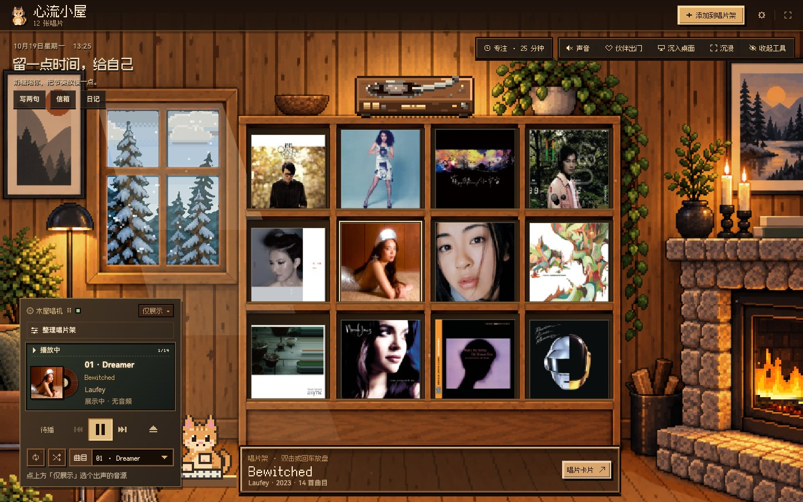
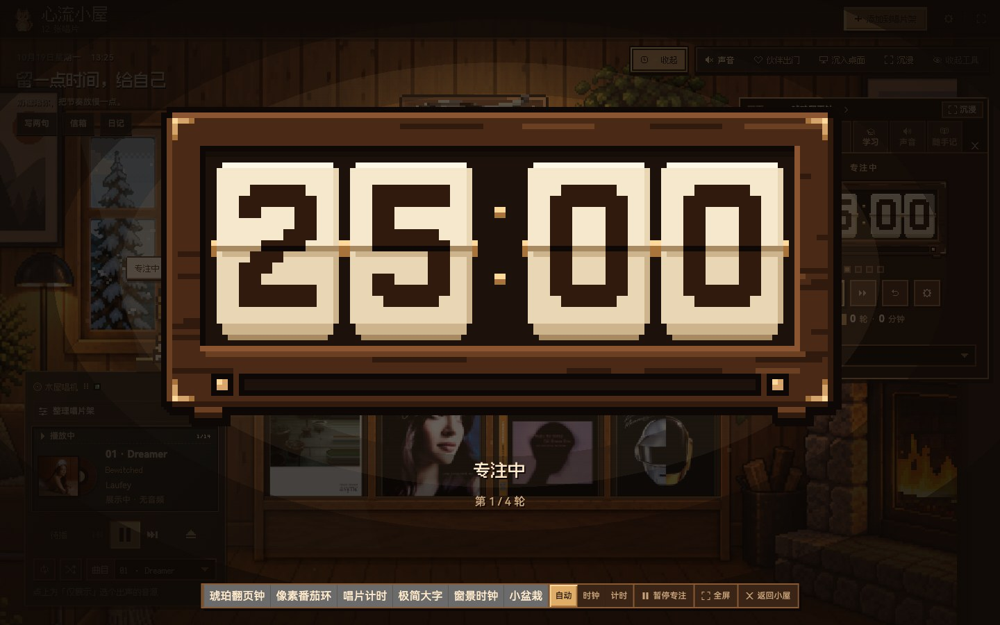
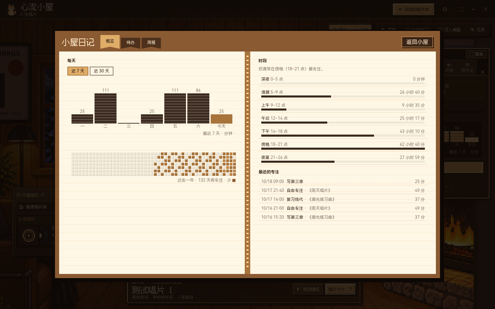
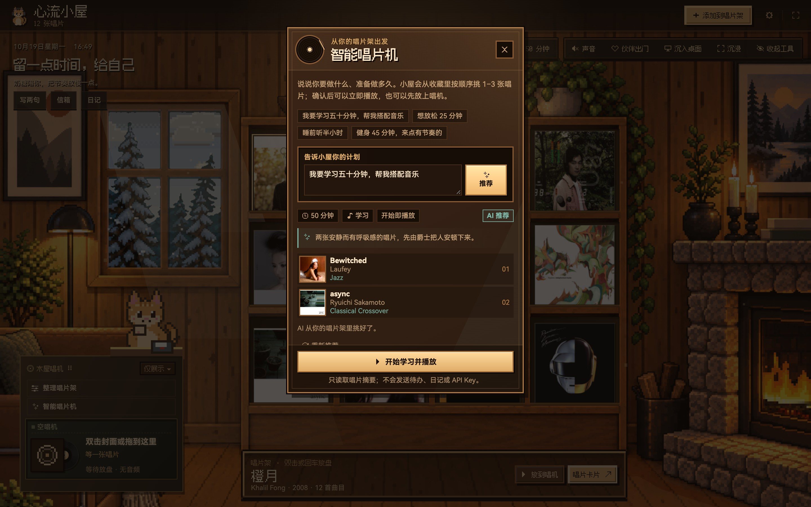
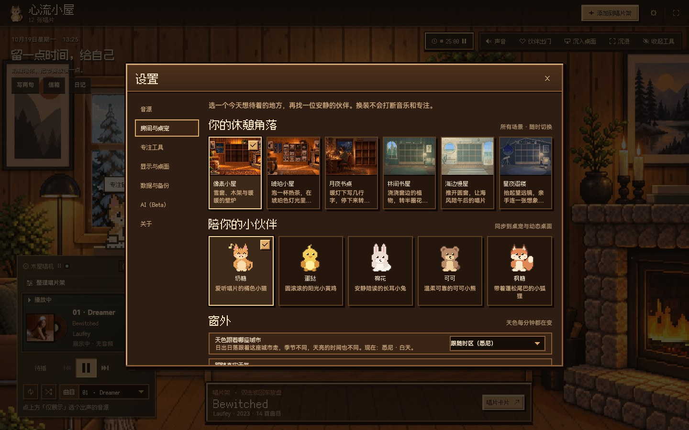
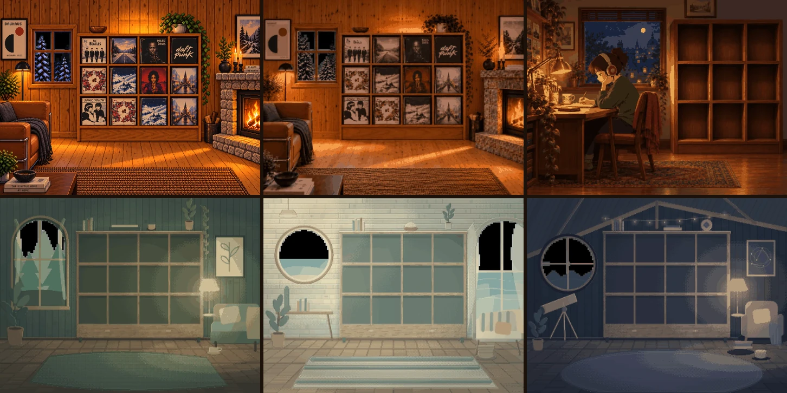
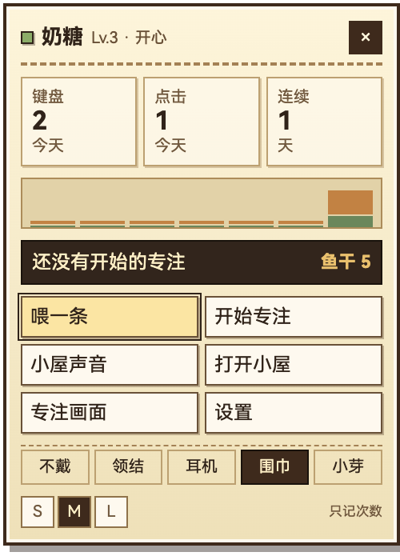

<div align="center">


# 心流小屋 · Flow Cabin

**听一张喜欢的唱片，安心做完这一轮，再把日子轻轻收好。**

<sub>一间会下雪、会亮灯、会等你回来的像素小屋。</sub>

<p>
  <a href="https://github.com/ooooooomygosh/Flow-Cabin/releases/latest"><b>下载最新版 ↓</b></a>
  &nbsp;·&nbsp;
  <a href="https://album-circle.vercel.app/promo.html">宣传网站</a>
  &nbsp;·&nbsp;
  <a href="https://album-circle.vercel.app/">网页版</a>
  &nbsp;·&nbsp;
  <a href="docs/getting-started.md">第一次使用</a>
</p>

<p>
  <a href="https://github.com/ooooooomygosh/Flow-Cabin/actions/workflows/ci.yml"></a>
  <a href="https://github.com/ooooooomygosh/Flow-Cabin/releases/latest"></a>
  
  
  <a href="LICENSE"></a>
</p>



</div>

---

## 里面有什么

- **唱片架与唱机** —— 搜专辑、贴 QQ 音乐链接或手填；双击封面就放上唱机，拖过去也行。每张能写笔记、换黑胶外观、收进唱片盒。
- **智能唱片机** —— 说一句「学习 50 分钟，帮我搭配音乐」，AI 排一整张歌单；可以只收进唱片架，也可以收下并直接开始这一轮。
- **专注与学习** —— 四档番茄节奏、待办、连续天数、7 天趋势、一年热力图；15 本词书用 FSRS 复习，还能加自己的考试倒计时。
- **六个房间** —— 像素、琥珀、月夜书桌、林间书屋、海边慢屋、星夜阁楼。窗外天色跟着太阳走，天气和城市可以自己选。
- **奶糖** —— 桌面版在别的窗口打字或点鼠标时，它会落爪回应；只统计次数，不读按键内容。
- **小屋日记** —— 随手记、手记和小屋来信都存在本机；近 7 天、时段分布、一年热力图和周报都能导出成图片。

<table>
  <tr>
    <td width="50%"><br><sub>专注 · 待办 · 统计 · 学习 · 声音 · 随手记</sub></td>
    <td width="50%"><br><sub>小屋日记 · 近 7 天 · 一年热力图 · 时段分布</sub></td>
  </tr>
  <tr>
    <td width="50%"><br><sub>智能唱片机 · 按计划编排一张完整歌单</sub></td>
    <td width="50%"><br><sub>房间与桌宠 · 六间房 · 五位伙伴 · 窗外天色</sub></td>
  </tr>
</table>

---

## 六间房



<sub>像素小屋 · 琥珀小屋 · 月夜书桌 · 林间书屋 · 海边慢屋 · 星夜阁楼</sub>

---

## 奶糖会陪你用电脑

<div align="center">
  
</div>

桌面版在「设置 › 键鼠陪伴」打开跨应用陪伴后，即使心流小屋在后台，你打字时它也会轮流落爪，点击鼠标时它会伸手回应。完成专注赚到的小鱼干可以换配饰。

只处理事件类型与时间戳，不保存按键、鼠标按钮、坐标、应用名或窗口标题。几天不开门，奶糖不会生病也不会离开，等级更不会掉；只是心情会慢慢降到「无精打采」停在那里，等你回来。

<sub>macOS 首次使用只需授予「输入监控」。普通字母和数字已在真实 Mac 上验证过；中文输入法组合还没有在真机上验收。版本更新后引导会复核一次，已授权时不会重复弹窗。</sub>

---

## 下载

[**前往 Releases 选择安装包 →**](https://github.com/ooooooomygosh/Flow-Cabin/releases/latest)

当前版本 **v1.21.4**，逐版本改动见[发布说明](desktop/RELEASE-NOTES.md)。

| 平台 | 安装包 |
| --- | --- |
| macOS | Apple Silicon · Intel（DMG 或 ZIP） |
| Windows | x64 安装版 · x64 便携版 |

不确定挑哪个文件，照[安装说明](docs/getting-started.md#安装与首次打开)里的文件名对一下就行。目前没有 Windows ARM64 原生包，也没有 Linux 安装包。

---

## 先说清楚几件事

这四条会直接影响你能不能顺畅用下去，所以放在下载后面。

- **安装包没有完成商业签名与公证。** macOS 用的是稳定的自签名发布身份，不是 Apple Developer ID；Windows 没有可信发布者签名。第一次打开被系统拦下时，先核对下载来源，别为了装上它去关掉系统安全保护。
- **QQ 音乐 / 网易云走的是非官方接口。** 基于 [Simple Music](https://github.com/Yyyangshenghao/simple-music) 模块，不宣称官方合作授权；能不能播、能不能听全，取决于你的账号、版权、会员和地区。
- **macOS 的系统集成需要一次授权。** 用「系统 Apple Music」或「系统正在播放」会弹一次「自动化」授权；跨应用键鼠陪伴只需要「输入监控」。没有这些授权，收藏、普通专注和屋里的键鼠回应照常可用。
- **网页版功能少于桌面版。** 网页版不能登录 QQ / 网易云，没有 Music Assistant、桌宠、动态桌面、自动更新和本机 Codex CLI；它只在小屋窗口内响应键鼠。

更完整也更严格的功能与验证状态见[使用边界](docs/limitations.md)——那份文档区分「已实现」「自动化已验证」和「真实设备已验证」，里面写着的未验收项就是未验收项。

---

## 跑起来

只想用软件，下载安装包就够了，不用装 Node。想改代码或自己跑起来，需要 **Node.js 24.x**。

```bash
git clone https://github.com/ooooooomygosh/Flow-Cabin.git
cd Flow-Cabin
npm ci                  # 根项目依赖
npm --prefix desktop ci # 桌面端依赖

npm run desktop:dev     # 启动完整 Electron 客户端
npm run dev             # 只启动浏览器渲染层（Vite）
```

提交前跑 `npm run check`（= `npm test` + `npm run build`）。更多命令见 [desktop/README.md](desktop/README.md)。

---

## 文档与贡献

React 19 · Vite 8 · Electron 44 · Tone.js · Web Audio · FSRS · `node:test` · Playwright

[第一次使用](docs/getting-started.md) · [使用边界](docs/limitations.md) · [架构说明](docs/architecture.md) · [播放器与音源](docs/player.md) · [美术规范](docs/art-direction.md) · [入口与模式](docs/entry-map.md) · [桌面开发](desktop/README.md)

欢迎提交 Issue、修复 Bug 或补充真实设备验证。开始前请读[贡献指南](CONTRIBUTING.md)。

## 许可与致谢

Copyright © 2026 心流小屋 · Flow Cabin contributors。

本项目以 **GPL-3.0-only** 提供，许可证全文见 [LICENSE](LICENSE)。桌面发行包组合了 GPL-3.0-only 的 [Simple Music](https://github.com/Yyyangshenghao/simple-music) 模块，来源与许可见 [SOURCE.txt](desktop/vendor/simple-music/SOURCE.txt) 与 [其许可证](desktop/vendor/simple-music/LICENSE)。完整的许可与依赖边界见[许可与依赖](docs/limitations.md#许可与依赖)。

专辑封面版权归各唱片公司 / 艺术家所有，仅用于界面展示，不包含在项目许可范围内。

灵感来自 [Bongo Cat](https://github.com/ayangweb/BongoCat) 的跨应用键鼠陪伴思路，以及 Chill Pulse、lofi-engine 等作品；角色与场景美术均为本项目原创。感谢 [Tone.js](https://tonejs.github.io/)、[Simple Music](https://github.com/Yyyangshenghao/simple-music)、[Music Assistant](https://github.com/music-assistant/server) 与像素字体 [Fusion Pixel](https://github.com/TakWolf/fusion-pixel-font)。

<div align="center">
<sub>Made with ☕ and lo-fi in a small pixel cabin.</sub>
</div>
